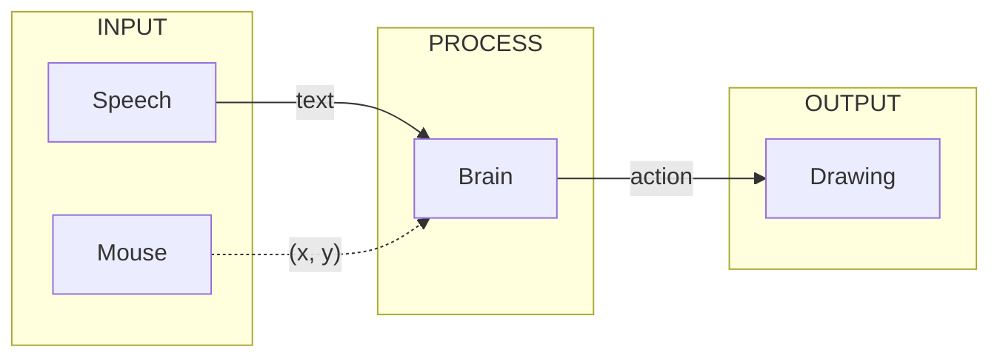

# Put That There: workshop

Point at the canvas, say **"draw a red circle here"**, and a small AI model in your browser draws it.



**Fell behind?** Replace your `sketch.js` with the step's checkpoint.

## Setup

Use **desktop Chrome**. Keep the p5 Editor's console open.

Make a new sketch in the [p5 Web Editor](https://editor.p5js.org/).

The [p5.js collection](https://editor.p5js.org/jasongao97/collections/FYeiyFz8t) has the finished workshop and extended sketches to try or use as a reference.

---

## Step 1 · Input: hear the words

Above `setup()`:

```js
const recognition = new SpeechRecognition();
recognition.lang = "en-US";
recognition.continuous = true;

recognition.onresult = ({ results, resultIndex }) => {
  const transcript = results[resultIndex][0].transcript;
  console.log(transcript);
};
```

As the last line inside `setup()`:

```js
  recognition.start();
```

Press Play, allow the mic, and say "hello world". Your words appear in the console.

- `SpeechRecognition` is built into Chrome. `continuous` keeps it listening.
- `onresult` runs each time the browser hears a sentence; `transcript` is that sentence as text.
- Docs: [MDN · SpeechRecognition](https://developer.mozilla.org/en-US/docs/Web/API/SpeechRecognition)

Checkpoint: [1.js](workshop/checkpoints/1.js)

## Step 2 · Output: a function that draws

At the bottom of `sketch.js`:

```js
function drawShape({ shape, color, x = width / 2, y = height / 2 }) {
  fill(color);
  if (shape === "circle") {
    circle(x, y, 50);
  } else if (shape === "square") {
    square(x, y, 50);
  }
}
```

Press Play, then type this in the console and press Enter:

```js
drawShape({ shape: "square", color: "blue", x: 100, y: 100 })
```

- `drawShape` takes one object: `{ shape, color, x, y }`. The model will send us this same object later.
- `x = width / 2` is a default: without `x` and `y`, the shape goes in the center.

Checkpoint: [2.js](workshop/checkpoints/2.js)

## Step 3 · Brain: from keywords to a language model

### A first brain: keywords

Inside `onresult`, below `console.log(transcript);`:

```js
  if (transcript.includes("circle")) {
    drawShape({ shape: "circle", color: "red" });
  }
```

Say "draw a circle". Then try:

- "Draw a **blue** circle"
- "**Don't** draw a circle"
- "Create a round thing"

Every new phrasing needs a new rule. A language model understands meaning instead.

### Load the brain

At the top of `sketch.js`:

```js
let llm;
let status;
```

Below `setup()`:

```js
async function loadModels() {
  const { pipeline } = await import("https://cdn.jsdelivr.net/npm/@huggingface/transformers@4.3.0");
  llm = await pipeline("text-generation", "onnx-community/Qwen3-0.6B-ONNX", {
    device: "webgpu",
    dtype: "q4f16",
    progress_callback: (p) => {
      if (p.status === "progress") status.html(`Loading ${p.file} ${round(p.progress)}%`);
    },
  });
  status.html("Model loaded. Start talking!");
  recognition.start();
}
```

In `setup()`, replace `recognition.start();` with:

```js
  status = createP("Loading model...");
  loadModels();
```

- `import(...)` loads Transformers.js, a library that runs models in the browser.
- `pipeline(...)` downloads Qwen3-0.6B and runs it on the GPU (`webgpu`) in 4-bit form (`q4f16`).
- `recognition.start()` moves to the end, so we only listen once the model is ready.

Press Play. Loading takes about a minute.

### Talk to it

At the bottom of `sketch.js`:

```js
async function act(prompt) {
  const messages = [
    { role: "system", content: "You are a helpful agent." },
    { role: "user", content: prompt },
  ];

  const response = await llm(messages, {
    tokenizer_encode_kwargs: { enable_thinking: false },
  });
  const reply = response[0].generated_text.at(-1).content;
  console.log(reply);
}
```

In `onresult`, replace the keyword `if` block with:

```js
  act(transcript);
```

Say "draw a red circle". The model replies with text, but nothing is drawn. Why?

- `messages` is the conversation: **system** gives the model its job, **user** is what you said.
- `await` waits for the reply without freezing the page.
- `enable_thinking: false` makes it answer faster.
- `.at(-1)` takes the last message, which is the model's reply.

Checkpoint: [3.js](workshop/checkpoints/3.js)

## Step 4 · Tool calling

The model can only write text. So we describe a **function** it can call.

Above `async function act`:

```js
const tools = [
  {
    type: "function",
    function: {
      name: "create",
      description: "draw a shape",
      parameters: {
        type: "object",
        properties: {
          shape: {
            type: "string",
            enum: ["circle", "square"],
          },
          color: {
            type: "string",
            description: "color name, e.g. red, blue, green",
          },
          x: {
            type: "number",
            description: "in pixels, 0 is left",
          },
          y: {
            type: "number",
            description: "in pixels, 0 is top",
          },
        },
        required: ["shape", "color", "x", "y"],
      },
    },
  },
];
```

- `name` and `description` tell the model what the function does.
- `properties` are the same four fields as `drawShape`. `enum` limits `shape` to circle or square.
- This only describes the function. The model can't run anything.

In `act()`, add `tools,` to the `llm(...)` call:

```js
  const response = await llm(messages, {
    tools,
    tokenizer_encode_kwargs: { enable_thinking: false },
  });
```

### Run the tool call

Say "draw a red circle". The reply is now a request:

```text
<tool_call>
{"name": "create", "arguments": {"shape": "circle", "color": "red"}}
</tool_call>
```

In `act()`, after `console.log(reply);`:

```js
  const matches = reply.matchAll(/<tool_call>(.*?)<\/tool_call>/gs);
  for (const match of matches) {
    const call = JSON.parse(match[1]);
    console.log(call);
    drawShape(call.arguments);
  }
```

- `matchAll` finds the text between each pair of `<tool_call>` tags.
- `JSON.parse` turns that text into the same object you typed in Step 2, and `drawShape` draws it.

Say "draw a blue square". 🎉 Now point at a corner and say "draw a red circle **here**". What goes wrong?

Checkpoint: [4.js](workshop/checkpoints/4.js)

## Step 5 · Put "here" in the context

The model can't see the canvas or the mouse. It only knows what's in `messages`.

In `act()`, change the two messages to:

```js
    { role: "system", content: "You control a 400 by 400 canvas." },
    { role: "user", content: `I am pointing at (${mouseX}, ${mouseY}), ` + prompt },
```

- The canvas size makes words like "top left" meaningful.
- The mouse position becomes part of the sentence.

Point, say "draw a red circle here", and **hold the mouse still** until it appears. Then try "put a green square in the top left".

Finished sketch: [Open in the p5 Web Editor](https://editor.p5js.org/jasongao97/sketches/1Vw9jKi72) · [Source](workshop/sketch.js)

## If something breaks

Check the console to find which part failed: the transcript (input), the `<tool_call>` (brain), or the drawing (output).

| Problem                            | Try                                                  |
| ---------------------------------- | ---------------------------------------------------- |
| `SpeechRecognition is not defined` | Use Chrome or another Chromium-based browser.        |
| It stops listening                 | Add `recognition.onend = () => recognition.start();` |
| Model won't load                   | The laptop may not support WebGPU.                   |
| `JSON.parse` error                 | Try again. The model sometimes writes a bad format.  |

No mic? Type `act("draw a red circle")` in the console.

## What's next

The [extended sketch](https://editor.p5js.org/jasongao97/sketches/xLu7OoItg) picks up where today's sketch ends:

- **More to draw:** triangles, and a `size` for each shape.
- **More tools:** `move`, `recolor`, `resize` and `delete`. Point at a shape and say "make that green" or "move it to the right".

Run it in the p5 Web Editor, then click **Start** to try it. The [source files](extended/) are also in this repository, and the [README](README.md#the-extended-sketch) explains how it works.
